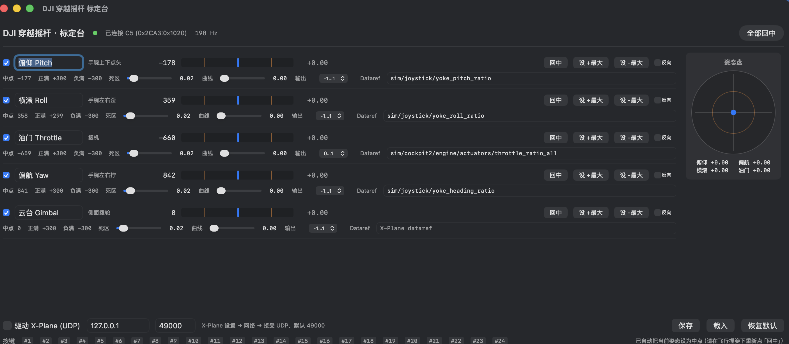
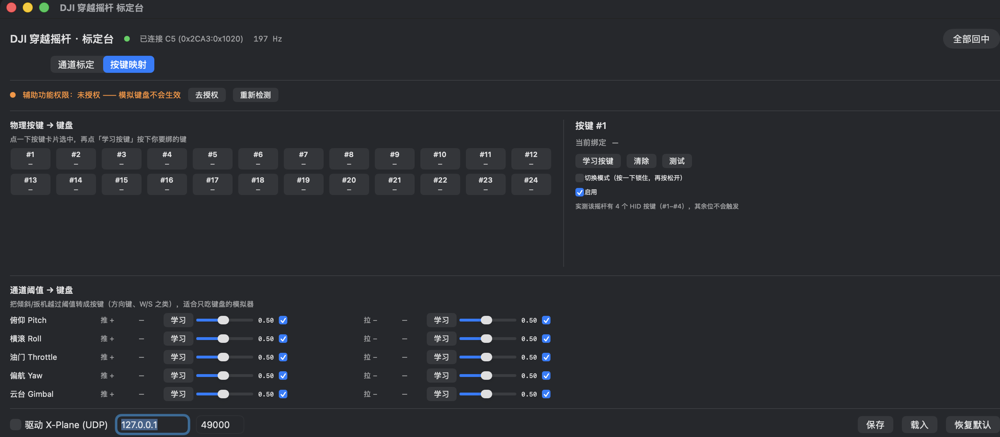

# DJI Motion Controller for macOS — Calibration Studio

Turn the **first-generation DJI FPV Motion Controller** (`VID 0x2CA3 / PID 0x1020`) into a usable
flight-sim joystick on macOS.

> DJI never shipped macOS driver or simulator support for this controller. But it *is* already a
> standard HID Game Pad — what actually breaks is (1) simulators' game-controller layer rejects it,
> and (2) its axes report **absolute hand attitude**, not a centred stick offset.
> This project fixes both.





---

## What the device really is

The 1st-gen Motion Controller is a **motion controller**: no mechanical gimbal, attitude comes from an
IMU. Its physical controls are the lock/brake button, throttle trigger, gear button, emergency stop,
**gimbal tilt slider**, and record button.

Plugged into macOS it enumerates as a composite device: **1 HID Game Pad + 2 CDC-ACM serial ports**.

### HID report — 13 bytes, ~196 Hz, no Report ID

| Offset | Size | Content |
|---|---|---|
| 0..2 | 3 B | 24-button bitmap (little-endian, bit0 = Button 1) |
| 3..4 | int16 LE | **X** |
| 5..6 | int16 LE | **Y** |
| 7..8 | int16 LE | **Z** |
| 9..10 | int16 LE | **Rx** |
| 11..12 | int16 LE | **Ry** |

### Axis map (verified by labelled gesture capture)

| Axis | Physical motion | Measured span |
|---|---|---|
| **X** | pitch — nod the wrist up/down | ±250–296 |
| **Y** | roll — tilt the wrist left/right | 501 |
| **Rx** | yaw — twist the wrist | 855 |
| **Z** | throttle trigger | `-660 → +660` (one-directional, span 1313) |
| **Ry** | gimbal tilt slider | spring-centred, rests at `0` |

### It reports absolute attitude

Measured over 96 seconds at rest it drifts by **one count** — rock stable. But the resting values are
`X=-301 Y=-392 Rx=-729`: **they do not sit at zero.**

The device reports *which way the body is pointing*, not *how far you pushed a stick*. Lying on a desk,
it believes you are permanently banked. You must calibrate once **in your flying grip** and declare
that pose as neutral — exactly what DJI's own app calls "calibration".

---

## Three ways to use it

### 1. Per-channel calibration + keyboard emulation (most reliable)

Every simulator and game accepts keyboard input, so this path needs no HID recognition, no driver,
and no entitlements beyond the Accessibility grant for synthetic key events.

Per channel:

1. Hold the controller in your **actual flying grip** → click **Recenter**
2. Tilt to the angle you want as full deflection → **Set +max**
3. Tilt the other way → **Set −max**

Ranges are stored **per side**, so an asymmetric feel (15° forward / 25° back) is directly reproducible.

Then map deflection to keys:

| Channel | Push + | Pull − |
|---|---|---|
| Pitch | ↓ | ↑ |
| Roll | → | ← |
| Yaw | E | Q |
| Throttle | = | - |

The four physical buttons (`#1–#4`) can each be bound to a key in **hold** or **toggle** mode.

### 2. SDL mapping string (Liftoff / Velocidrone / DRL / Uncrashed)

SDL's joystick layer sees the device, but its game-controller layer does not (`isGameController = 0`) —
so these sims treat it as nothing at all. One mapping line fixes it:

```bash
export SDL_GAMECONTROLLERCONFIG='0300703ba32c00002010000004040000,DJI C5,a:b0,b:b1,x:b2,y:b3,back:b4,start:b5,leftshoulder:b6,rightshoulder:b7,guide:b8,leftx:a0,lefty:a1,rightx:a3,righty:a4,lefttrigger:a2,platform:Mac OS X,'
```

Or append the line from [`docs/gamecontrollerdb.txt`](docs/gamecontrollerdb.txt) to the sim bundle's
`Contents/Resources/gamecontrollerdb.txt`.

> Dropping `gamecontrollerdb.txt` into the working directory does **not** get auto-loaded.

### 3. X-Plane UDP (DREF)

Enable "Drive X-Plane (UDP)" in the client; it pushes at 50 Hz:

| Channel | dataref |
|---|---|
| Pitch | `sim/joystick/yoke_pitch_ratio` |
| Roll | `sim/joystick/yoke_roll_ratio` |
| Yaw | `sim/joystick/yoke_heading_ratio` |
| Throttle | `sim/cockpit2/engine/actuators/throttle_ratio_all` |

This bypasses the HID-recognition problem entirely. Don't also assign axes to `C5` inside X-Plane,
or the two input paths will fight.

---

## Quick start

Requires macOS 13+ and Xcode Command Line Tools (`xcode-select --install`).

```bash
git clone https://github.com/zhanghanlin10/dji-motion-controller-macos.git
cd dji-motion-controller-macos
./client/build.sh
open "client/DJI 穿越摇杆 标定台.app"
```

For keyboard emulation, grant Accessibility:
**System Settings → Privacy & Security → Accessibility → enable `DJI 穿越摇杆 标定台`**

> The app is ad-hoc signed locally, so **every rebuild** may require re-granting the permission.

## Layout

```
client/   SwiftUI app (calibration + keyboard emulation + X-Plane UDP)
tools/    C diagnostics used during reverse engineering
docs/     full protocol write-up, SDL mapping, screenshots
```

## Limitations

- Only the **1st-gen** controller is verified. Later revisions may use different VID/PIDs —
  check with `hidutil list | grep 0x2ca3`.
- macOS user space cannot create a system-level virtual HID joystick (that needs Apple's
  `com.apple.developer.hid.virtual.device` entitlement). Hence: SDL mapping, keyboard, UDP,
  or a hardware bridge such as an RP2040.
- Calibration is one-shot; changing grip requires re-centring.

## License

MIT
