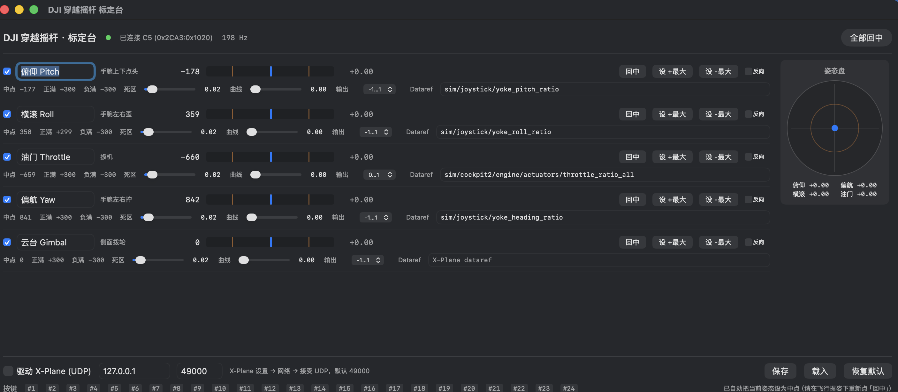
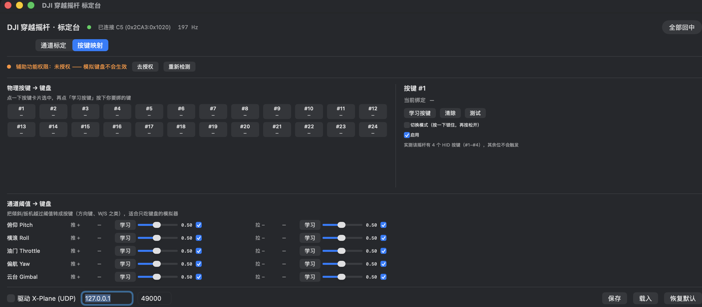

# DJI 穿越摇杆 · macOS 标定台

把**大疆初代穿越摇杆**（DJI FPV Motion Controller，`VID 0x2CA3 / PID 0x1020`）变成 macOS 上可用的飞行摇杆。

> 它本身就是个标准 HID Game Pad。真正需要处理的是三件事：模拟器的控制器层不认它、
> 它输出的是**地球坐标系的绝对姿态**而不是摇杆偏移量、以及**航向是绝对角度**而不是偏航量。
> 这个项目把三件事都处理了，全部走 macOS 公开 API，不装驱动、不改系统安全策略。





---

## 这根杆的数据结构

初代穿越摇杆是**体感控制器**：没有机械摇杆，姿态来自 IMU。物理控件只有
锁键（刹车）、油门扳机、档位键、急停、**云台俯仰三档开关**、录像键。

插上 macOS 后枚举成复合设备：**1 个 HID Game Pad + 2 个 CDC-ACM 串口**。

### HID 报文（13 字节，约 196 Hz，无 Report ID）

| 偏移 | 长度 | 内容 |
|---|---|---|
| 0..2 | 3 B | 24 键位图（小端，bit0 = Button 1） |
| 3..4 | int16 LE | **X** |
| 5..6 | int16 LE | **Y** |
| 7..8 | int16 LE | **Z** |
| 9..10 | int16 LE | **Rx** |
| 11..12 | int16 LE | **Ry** |

### 五根轴的真实语义

| 轴 | 实际含义 | 实测满量程 |
|---|---|---|
| **X / Y** | **地球坐标系**下的姿态分量——不是机身俯仰/横滚 | ±1024 |
| **Rx** | **绝对航向**（−π..π，正北 = 0，绕到正南处跳变） | ±1024 |
| **Z** | 油门扳机 | `-660 .. +660`（= ±0.64 满量程） |
| **Ry** | 云台俯仰**三档开关**（上 / 中 / 下） | `−0.64 / 0 / +0.64` |

只有 **4 个**物理按键会出现在键位图里（`#1–#4`）。

### 为什么不能直接当摇杆用

**① X / Y 在地球系，不是机身系。** 你转动身体朝向，X 和 Y 会一起变。
想拿到机身的俯仰/横滚，必须先按航向旋转：

```
h     = Rx / 1024 · π
Pitch = −( Y/1024 · cos h − X/1024 · sin h )
Roll  = −( X/1024 · cos h + Y/1024 · sin h )
```

这个变换是正交的（模长守恒），本项目的 `updateVirtual()` 就是用这两行实现的。
客户端里勾「**手部坐标系**」即启用；不勾则直通原始 X/Y。

**② Rx 是绝对航向，不是偏航量。** 把杆转到正北 Rx=0，正东 ≈ +0.5，正南 ≈ ±1 后跳变。
直接把它接到方向舵上会一直满舵乱转。客户端里勾「**锁定 (Ry 触发)**」后：

- 按住云台开关上档 → 以按下的那一刻为基准，追踪相对航向当偏航用
- 松开 → 偏航归零，可以自由甩手

**③ 静止值不归零。** 静止 96 秒只漂 1 个计数，很稳——但静止值是 `X=-301 Y=-392 Rx=-729`，
因为那是「当前朝向」。所以必须**用飞行握姿标定一次**，把那一刻定义为中立点。

---

## 三种用法

### ① 通道标定 + 模拟键盘（最稳，推荐）

任何模拟器/游戏都吃键盘，不依赖 HID 识别、不需要驱动、不需要系统级授权。

每个通道独立标定：

1. 摆出**实际飞行握姿** → 点「回中」
2. 向前倾到想当满舵的角度 → 「设 +最大」
3. 向后倾到反向满舵 → 「设 -最大」

量程**正负分开存**，所以「向前 15°、向后 25°」这种真实手感可以直接复刻。

再把倾斜量映射成按键：

| 通道 | 推 + | 拉 − |
|---|---|---|
| 俯仰 | ↓ | ↑ |
| 横滚 | → | ← |
| 偏航 | E | Q |
| 油门 | =（或 W） | -（或 S） |

物理按键 `#1–#4` 也能各自绑一个键盘键，支持**按住**和**切换**两种模式。

### ② SDL 映射串（Liftoff / Velocidrone / DRL / Uncrashed）

SDL 的摇杆层能看见它，但控制器层不认（`isGameController = 0`）——这些模拟器里它就是空气。

```bash
export SDL_GAMECONTROLLERCONFIG='0300703ba32c00002010000004040000,DJI C5,a:b0,b:b1,x:b2,y:b3,back:b4,start:b5,leftshoulder:b6,rightshoulder:b7,guide:b8,leftx:a0,lefty:a1,rightx:a3,righty:a4,lefttrigger:a2,platform:Mac OS X,'
```

或把 [`docs/gamecontrollerdb.txt`](docs/gamecontrollerdb.txt) 里那行追加到模拟器包内
`Xxx.app/Contents/Resources/gamecontrollerdb.txt`。

> 把 `gamecontrollerdb.txt` 放在工作目录**不会**被自动加载。

### ③ X-Plane UDP 直驱

勾「驱动 X-Plane (UDP)」，按 50 Hz 用 DREF 推送：

| 通道 | dataref |
|---|---|
| 俯仰 | `sim/joystick/yoke_pitch_ratio` |
| 横滚 | `sim/joystick/yoke_roll_ratio` |
| 偏航 | `sim/joystick/yoke_heading_ratio` |
| 油门 | `sim/cockpit2/engine/actuators/throttle_ratio_all` |

绕开「模拟器认不认这块 HID」的全部问题。用时别在 X-Plane 里再给 `C5` 指派轴。

---

## 与既有实现的对照

搜索 GitHub / 全网后，同一支杆只有极少数项目做过，且**没有 macOS 原生实现**：

| 项目 | 平台 | 做法 | 是否处理航向 |
|---|---|---|---|
| [f2knpw/DJI_motionController_JoystickGremlin_Plugin](https://github.com/f2knpw/DJI_motionController_JoystickGremlin_Plugin) | Windows | JoystickGremlin 插件 + vJoy，Python | ✅ 旋转 + Ry 锁存 |
| [Hackaday #204697](https://hackaday.io/project/204697-hacking-dji-motion-controller-as-regular-joystick) | Android | B4A 测试 App + 研究笔记 | ✅ 旋转 + Ry 锁存 |
| [Achilles10101/dji-rc-mac](https://github.com/Achilles10101/dji-rc-mac) | macOS | 树莓派中转成 USB HID 手柄（DJI RC，非本杆） | — |
| **本项目** | **macOS 原生** | **HID 直读 + 标定 + 模拟键盘 + UDP** | ✅ 旋转 + Ry 锁存 |

本项目的差异：不依赖 vJoy / ViGEm / JoystickGremlin 这类 Windows 专有虚拟手柄驱动，
也不用树莓派——macOS 上靠**键盘合成**和 **UDP** 两条通道落地。

几个数值互相印证：

| 项 | 本项目实测 | 他人结论 |
|---|---|---|
| 按键数 | 只有 `#1–#4` 会亮 | 「4 buttons, 5 axes」 |
| 扳机满量程 | `−660..+660`（±0.645） | 「Z capped at ±0.64」 |
| 云台轴静止值 | 恒为 `0` | 三档开关中位 |

---

## 快速开始

要求：macOS 13+、Xcode Command Line Tools（`xcode-select --install`）。

```bash
git clone https://github.com/zhanghanlin10/dji-motion-controller-macos.git
cd dji-motion-controller-macos
./client/build.sh
open "client/DJI 穿越摇杆 标定台.app"
```

模拟键盘需要辅助功能授权：
**系统设置 → 隐私与安全性 → 辅助功能 → 勾选 `DJI 穿越摇杆 标定台`**

> app 为本地自签名（ad-hoc）。**每次重新编译后**系统会忘记授权，需重新勾一次。

配置保存在 `~/Library/Application Support/DJIJoystickClient/profile.json`。

---

## 目录结构

```
client/          SwiftUI 客户端（标定 + 模拟键盘 + X-Plane UDP）
  DJIJoystickClient.swift
  build.sh
tools/           逆向用的诊断工具（纯 C，无依赖）
  hid_dump.c       原始报文十六进制转储
  hid_watch2.c     动作事件识别
  dji_hud.c        终端实时 HUD + 回中捕获
  sdl_probe.c      看 SDL 能不能认出它
  sdl_map_test.c   验证映射串能否让 isGameController 翻成 1
docs/
  protocol.zh.md   完整逆向报告
  gamecontrollerdb.txt
  screenshots/
```

编译诊断工具：`./tools/build.sh`

---

## 已知限制

- **只验证过初代穿越摇杆**（配初代 DJI FPV）。后续型号 VID/PID 可能不同，
  用 `hidutil list | grep 0x2ca3` 确认。
- **macOS 用户态无法创建系统级虚拟 HID 摇杆**，需要 Apple 特批的
  `com.apple.developer.hid.virtual.device` 权限（社区做法是一次性放宽 AMFI 校验，
  本项目不采用）。所以走键盘 / SDL 映射 / UDP 三条路。
- **树莓派桥接要用能当 High-Speed 主机的板子**：Pi Zero 2 W / Pi 4 / Pi 5。
  RP2040、ESP32-S3 都是 Full-Speed 主机，读不了这根杆——它的中断端点 MPS 是 512 字节，
  远超 Full-Speed 主机的 64/128 字节上限，会直接报 `EP MPS exceeds supported limit`。
- 标定是一次性的：中途换握姿需要重新「回中」。
- 「手部坐标系」模式依赖航向读数，抬头低头幅度很大时航向会有轻微抖动，已由死区吸收。

---

## License

MIT
